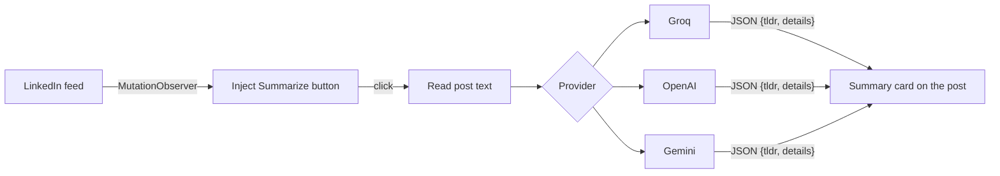

<div align="center">


# Feedbite

**A one-click TL;DR for every LinkedIn post.**

[Chrome Web Store](https://chromewebstore.google.com/detail/mnbbbmdiphmdplpgoligldmnifckogfc) · [Website](https://feedbite.vercel.app) · [Demo video](https://www.loom.com/share/c5028891276d46d983ca7ea387eac51a) · [Privacy policy](https://feedbite.vercel.app/privacy)


</div>

## What it does

Feedbite is a Chrome extension that adds a **Summarize** button to posts in your LinkedIn feed. Click it and the post collapses into:

- **TL;DR**: one sentence with the point of the post
- **Details**: a short paragraph of the key takeaways

It uses your own API key from Groq, OpenAI or Google Gemini, so it's free to use, needs no account, and your posts go straight from your browser to the provider you picked. There's no Feedbite server in between.

## Install

1. Install **Feedbite** from the [Chrome Web Store](https://chromewebstore.google.com/detail/mnbbbmdiphmdplpgoligldmnifckogfc).
2. Click the Feedbite icon in the toolbar, pick a provider and paste your API key.
3. Open [linkedin.com](https://www.linkedin.com/feed/) and click **Summarize** on any post.

| Provider | Default model | Get a key |
| --- | --- | --- |
| Groq (default) | `llama-3.3-70b-versatile` | [console.groq.com/keys](https://console.groq.com/keys) |
| OpenAI | `gpt-4o-mini` | [platform.openai.com/api-keys](https://platform.openai.com/api-keys) |
| Google Gemini | `gemini-1.5-flash` | [aistudio.google.com/app/apikey](https://aistudio.google.com/app/apikey) |

You can type any other model name from the same provider in the popup to override the default.

## How it works



- A content script runs only on `linkedin.com`. LinkedIn loads posts as you scroll, so a `MutationObserver` watches the feed and adds a button to each new post.
- The post text is sent to the chosen provider with an instruction to return JSON with exactly two keys, `tldr` and `details`, which are rendered in a card under the post.
- The popup saves the provider, keys and model in `chrome.storage.local`. They never leave your browser except in the request to the provider.
- The extension asks only for `activeTab` and `storage`, plus host access to `https://*.linkedin.com/*`.

## This repository

This repo holds two things:

| Path | What it is |
| --- | --- |
| [`public/extension/`](public/extension) | The Chrome extension itself (Manifest V3, plain JavaScript and CSS) |
| [`src/`](src) | The landing site at [feedbite.vercel.app](https://feedbite.vercel.app), with a privacy policy page |

### Load the extension from source

1. Clone the repo.
2. Open `chrome://extensions` and turn on **Developer mode**.
3. Click **Load unpacked** and choose the `public/extension` folder.
4. After editing files, click the reload icon on the Feedbite card and refresh LinkedIn.

```
public/extension/
  manifest.json     permissions, content script, popup
  content.js        finds posts, injects the button, calls the provider, renders the card
  styles.css        button and summary card styles on LinkedIn
  popup.html/.js    provider, API key and model settings
  icons/
```

### Run the website

The site is a Vite + React + TypeScript app styled with Tailwind CSS and shadcn/ui, animated with Framer Motion, and routed with React Router.

```bash
git clone https://github.com/Stroller15/feedbite.git
cd feedbite
npm install
npm run dev
```

| Command | What it does |
| --- | --- |
| `npm run dev` | Start the dev server |
| `npm run build` | Production build into `dist/` |
| `npm run preview` | Serve the production build |
| `npm run lint` | ESLint |

The site is deployed on Vercel. `vercel.json` rewrites every path to `index.html` so routes like `/privacy` work on reload.

## Privacy

Feedbite has no backend and collects nothing. Your API key is stored locally in Chrome, and post text is sent only to the AI provider you choose, under that provider's terms. The full policy is at [feedbite.vercel.app/privacy](https://feedbite.vercel.app/privacy).

## Contributing

Issues and pull requests are welcome. LinkedIn changes its markup often, so if the button stops appearing, an issue with a screenshot of the post helps a lot.
